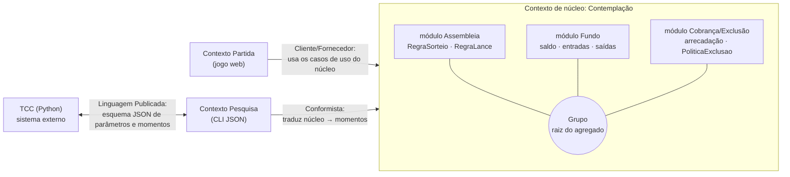
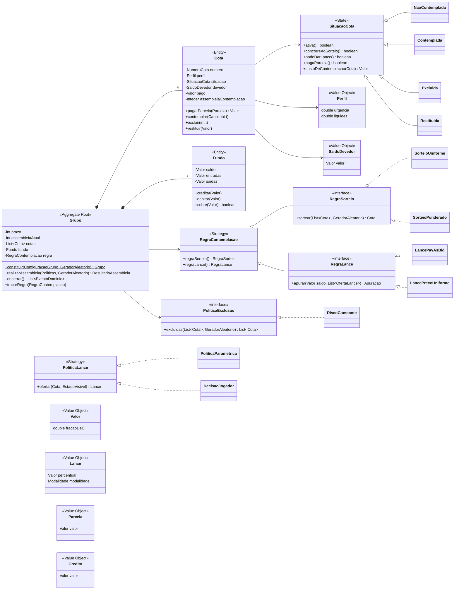
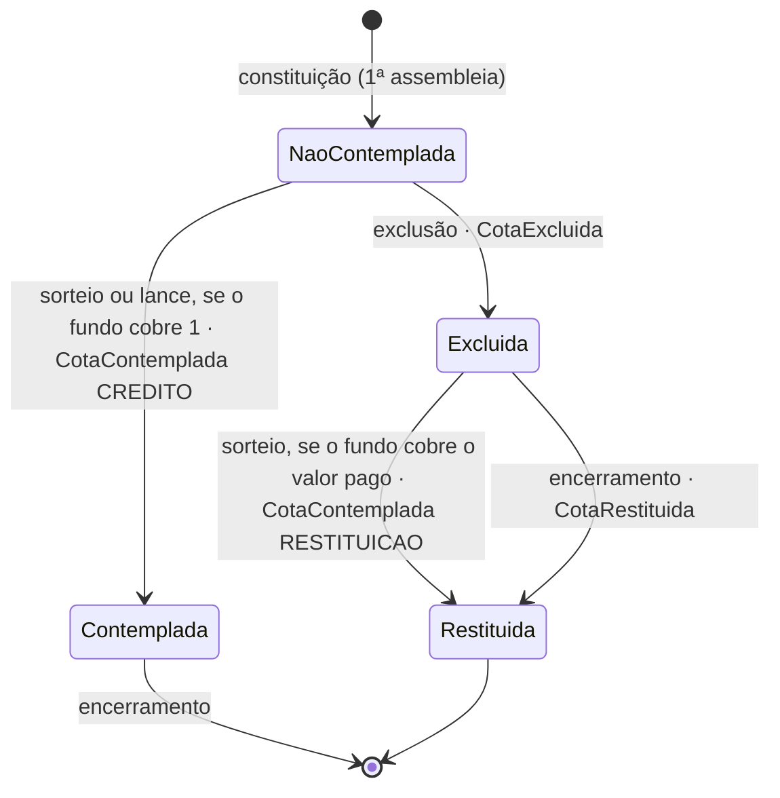
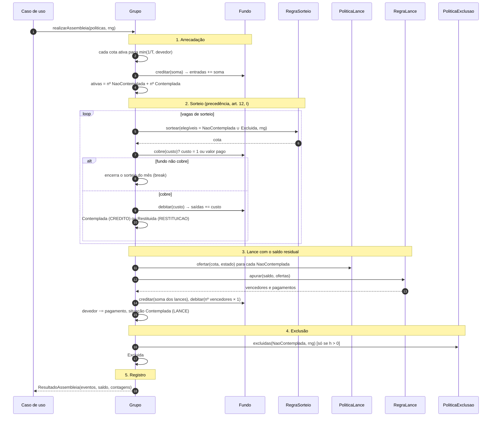
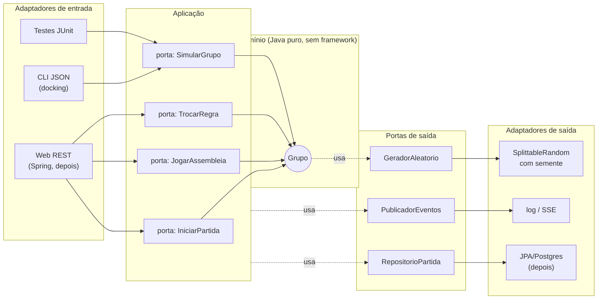

# Modelo de domínio: contemplação em grupo de consórcio (DDD)

> **Para que serve.** É o desenho do domínio do jogo de POO (`poo-jogo/`) e o caso real do seminário de TAPOO sobre DDD.
> **Especificação de referência:** o motor Python do TCC (`src/sim/grupo.py`, protótipo de 26/10, só M0). Quando este documento e o motor divergirem, vale o motor, e a divergência entra no `ESTADO.md` §4.
> **Fontes normativas:** Lei 11.795/2008 e Res. BCB 285/2023 com a redação da Res. BCB 362/2023, lidas no texto oficial em `refs/pdfs/` (conferido de novo em 15/11 para os artigos citados aqui).
> **Status:** rascunho de 15/11/2026. As decisões marcadas *pendente* estão no `ESTADO.md` §3/§4.

---

## 1. O problema de domínio em um parágrafo

Um grupo fechado de N cotas paga parcelas mensais a um fundo comum. Em cada assembleia o fundo financia contemplações: primeiro por sorteio, depois por lance com o que sobrou. Quem dá lance antecipa parcelas que ainda iria pagar. Cotas excluídas por inadimplência continuam no sorteio, mas, se sorteadas, recebem só o que pagaram. A pergunta do TCC é se outra regra de contemplação (M1, M2) aloca melhor. A pergunta do jogo é a mesma, vista por um único cotista: espero ou dou lance?

O núcleo difícil está em três coisas: a contemplação depende de haver dinheiro (o número de vagas é endógeno); o sorteio vem antes do lance; e o mesmo fundo paga crédito e restituição. Por isso o modelo gira em torno de um único agregado.

---

## 2. Linguagem ubíqua

Regra de nomes: o termo da lei vira o nome no código. Termos que só existem no modelo vêm da notação do TCC (`CONTEXT.md` §5) e estão marcados com *(modelo)*.

### 2.1 Termos da norma

| Termo | Significado no domínio | Fonte | No código |
|---|---|---|---|
| Consórcio | Reunião de pessoas em grupo, com prazo e número de cotas fixados, para adquirir bens por autofinanciamento, de forma isonômica | Lei, art. 2º | (nome do sistema) |
| Grupo de consórcio | Sociedade não personificada de consorciados; representado pela administradora | Lei, art. 3º | `Grupo` (raiz do agregado) |
| Consorciado | Quem integra o grupo e se obriga a contribuir para seus objetivos | Lei, art. 4º | `Consorciado` (uma cota por consorciado no modelo) |
| Cota | Posição no grupo; o número máximo de cotas ativas é fixado na constituição e não muda | Res. 285, art. 8º | `Cota` (entidade, id = número) |
| Administradora | Gestora do grupo e mandatária dos consorciados | Lei, art. 5º | fora do modelo: é quem executa `realizarAssembleia` |
| Constituição do grupo | Ocorre com a primeira assembleia | Lei, art. 16 | `Grupo.constituir(...)` |
| Assembleia geral ordinária | Reunião periódica que aprecia contas e realiza contemplações | Lei, art. 18 | `Assembleia` (módulo) e `ResultadoAssembleia` |
| Contemplação | Atribuição do crédito ao consorciado, **ou da restituição ao excluído** | Lei, art. 22; Res. 285, art. 11 | evento `CotaContemplada` com `finalidade` |
| Sorteio, lance | As duas formas de contemplação | Lei, art. 22, § 1º | `Canal.SORTEIO`, `Canal.LANCE` |
| Quem concorre | Consorciado ativo adimplente e o excluído (este só para restituição) | Lei, art. 22, § 2º; Res. 285, art. 11, § 1º | `SituacaoCota.concorreAoSorteio()` |
| Recursos suficientes | A contemplação depende de haver recursos no grupo para o crédito e para restituir excluídos | Lei, art. 23 | `Fundo.cobre(valor)` — invariante I1 |
| Precedência do sorteio | O lance só contempla depois dos sorteios previstos, ou se estes não ocorrerem por falta de recursos | Res. 285, art. 12, I | ordem fixa em `Grupo.realizarAssembleia` — invariante I4 |
| Destino do lance vencedor | Quitação ou amortização de prestações vincendas | Res. 285, art. 12, par. único (Res. 362) | o lance abate `SaldoDevedor` |
| Lance embutido | Uso de parte do próprio crédito para quitar vincendas; deduzido do crédito entregue | Res. 285, art. 13 | **fora do protótipo** (`Modalidade.EMBUTIDO` reservada) |
| Crédito | Valor do bem na data da assembleia de contemplação | Lei, art. 24 | `Credito` (objeto de valor; normalizado a 1) |
| Crédito parcial | O que o excluído recebe como restituição | Lei, art. 24, § 3º | `Credito.parcial(...)` |
| Fundo comum | Recursos do grupo para crédito, restituição e outros pagamentos; formado pelas parcelas | Lei, art. 25 | `Fundo` (entidade interna) |
| Prestação, parcela | Prestação = parcela do fundo comum + taxa de administração + demais obrigações. O modelo só tem a parcela do fundo comum | Lei, art. 27 | `Parcela` (objeto de valor; 1/T) |
| Saldo devedor | Valor não pago das prestações | Res. 285, art. 26 | `SaldoDevedor` (objeto de valor) |
| Consorciado ativo | Mantém vínculo obrigacional; **exclui** o inadimplente não contemplado e o excluído; **inclui** o contemplado | Lei, art. 21 | `SituacaoCota.ativa()` |
| Exclusão | Desistência, três vencimentos sem pagar, ou inadimplência na última assembleia | Res. 285, art. 32 (Res. 362) | evento `CotaExcluida`; no protótipo, risco mensal constante |
| Restituição ao excluído | Calculada pelo percentual amortizado do valor do bem | Lei, art. 30 | custo da contemplação de cota excluída = valor pago |
| Contemplado excluído | Mantém a contemplação, com crédito parcial | Res. 285, art. 33 | **fora do protótipo** (só não contemplados são excluídos) |
| Encerramento | Após a última assembleia; valores remanescentes vão aos consorciados | Lei, arts. 31–32; Res. 285, arts. 37–41 | `Grupo.encerrar()` |

### 2.2 Termos do modelo *(modelo)*

| Termo | Significado | Notação TCC | No código |
|---|---|---|---|
| Urgência | Quanto o consorciado valoriza receber cedo | θᵢ | `Perfil.urgencia` |
| Liquidez | Quanto ele consegue antecipar, em fração do crédito | λᵢ (no protótipo, fixa no tempo) | `Perfil.liquidez` |
| Política de lance | Regra que leva estado → lance | π_φ | `PoliticaLance` (Strategy) |
| Regra de contemplação | Como sorteio e lance são resolvidos | M₀, M₁, M₂ | `RegraContemplacao` (Strategy) |
| Fração restante | Assembleias que faltam, sobre T | (T − t)/T, t a partir de 0 | argumento da política |

### 2.3 Um conflito de linguagem que o código antigo tinha

No motor Python o estado `ATIVA` quer dizer "ativa **e ainda não contemplada**", mas a contagem `ativas` soma `ATIVA + CONTEMPLADA`. A lei (art. 21) usa "ativo" no sentido largo. Duas palavras para uma coisa e uma palavra para duas: é o tipo de ruído que a linguagem ubíqua existe para matar. No Java:

| Python (`grupo.py`) | Java (`SituacaoCota`) | `ativa()` | Observação |
|---|---|---|---|
| `ATIVA = 0` | `NaoContemplada` | sim | adimplente, concorre a sorteio e lance |
| `CONTEMPLADA = 1` | `Contemplada` | sim | continua pagando |
| `EXCLUIDA = 2` | `Excluida` | não | concorre só ao sorteio, para restituição |
| `RESTITUIDA = 3` | `Restituida` | não | estado final |

A tabela é também o mapeamento usado pela CLI JSON no docking.

---

## 3. Mapa de contextos

**Discordância registrada com o pedido inicial.** O pedido era tratar Assembleia, Fundo e Cobrança/Exclusão como três contextos delimitados. Não dá, por um motivo de domínio: a contemplação só acontece se o fundo cobrir o valor (Lei, art. 23), e cada contemplação muda ao mesmo tempo a situação da cota e o saldo do fundo. Esses dois fatos têm de mudar juntos, na mesma transação, sob a mesma invariante. Separá-los em contextos obrigaria a consistência eventual entre o "contexto Fundo" e o "contexto Assembleia", e a regra do art. 23 deixaria de ser garantida. Além disso, os três falam a mesma língua: "saldo", "cota", "contemplação" significam a mesma coisa nos três. Contexto delimitado é fronteira de linguagem, não de pasta.

Por isso o desenho fica com **um contexto de núcleo** (Contemplação), onde Assembleia, Fundo e Cobrança/Exclusão são **módulos**; e com dois contextos que de fato falam outra língua:

- **Partida** (jogo): fala de jogador, rodada, caixa, urgência que vence, pontuação, dica. "Ganhar" não existe no núcleo.
- **Pesquisa** (docking com o TCC): fala de semente, réplica, momento, distribuição. Não sabe o que é um jogador.

*(Pendente de aceite de Pedro. Se preferir os três contextos como pedido, o custo é o descrito acima; para o seminário, o contraste entre as duas versões é um bom slide.)*



Relações (nomes do catálogo de mapa de contextos do DDD):

| Relação | Tipo | O que significa aqui |
|---|---|---|
| Partida → Contemplação | Cliente/Fornecedor | O jogo pede o que precisa (decisão do jogador por assembleia) e o núcleo oferece porta para isso (`DecisaoJogador`) |
| Pesquisa → Contemplação | Conformista | A CLI aceita o modelo do núcleo como está e só o traduz para momentos |
| Pesquisa ↔ TCC | Linguagem Publicada | Os dois lados não compartilham código (regra 7 do `CLAUDE.md`); compartilham um esquema JSON versionado. É o único acoplamento entre Java e Python |

---

## 4. O agregado `Grupo`

### 4.1 Por que um agregado só

As invariantes abaixo envolvem, todas, cotas e fundo juntos. Um agregado é a menor unidade em que elas podem ser garantidas sem consistência eventual. O custo é que toda mudança passa pela raiz, o que num grupo de 600 cotas em memória não pesa.

### 4.2 Invariantes

| # | Invariante | Fonte | Onde é garantida |
|---|---|---|---|
| I1 | Saldo do fundo ≥ 0 | Lei, art. 23 | `Fundo.debitar` recusa valor acima do saldo |
| I2 | Entradas − saídas = saldo (conservação) | contabilidade | `Fundo` só muda por `creditar`/`debitar`, que somam nos contadores |
| I3 | Número de cotas fixo durante o grupo | Res. 285, art. 8º | lista de cotas imutável após `constituir` |
| I4 | Na assembleia, sorteio antes de lance | Res. 285, art. 12, I | ordem fixa em `Grupo.realizarAssembleia`; as estratégias não controlam a ordem |
| I5 | Só concorre ao sorteio cota `NaoContemplada` ou `Excluida` | Lei, art. 22, § 2º | `SituacaoCota.concorreAoSorteio()` |
| I6 | Só dá lance cota `NaoContemplada`; lance pago ≤ saldo devedor | Res. 285, art. 12, par. único | `SituacaoCota.podeDarLance()`; `min(lance, devedor)` |
| I7 | Cota contemplada uma vez só | — | transição de estado |
| I8 | Restituição ≤ valor pago, uma vez só | Lei, art. 30 | transição `Excluida → Restituida` |

### 4.3 Diagrama de classes do domínio



### 4.4 Entidades, objetos de valor e serviços

**Entidades** (têm identidade e ciclo de vida):
- `Grupo` — raiz. Identidade: código do grupo.
- `Cota` — identidade: número da cota no grupo. Duas cotas com o mesmo saldo e o mesmo perfil continuam sendo cotas diferentes.
- `Fundo` — entidade interna: só existe dentro do grupo, ninguém de fora segura referência para ele.

**Objetos de valor** (imutáveis, iguais quando os valores são iguais, validam a si mesmos na construção):

| VO | Conteúdo | Validação |
|---|---|---|
| `Valor` | fração do crédito C, `double` | finito; operações com tolerância 1e-12, a mesma do motor Python |
| `Lance` | percentual do próprio crédito + `Modalidade` (`LIVRE`; `EMBUTIDO` reservada) | ≥ 0 |
| `Parcela` | 1/T | T > 0 |
| `Credito` | valor do crédito (1) ou crédito parcial (restituição) | ≥ 0 |
| `SaldoDevedor` | fração de C ainda não paga | 0 ≤ s ≤ 1 |
| `Perfil` | urgência θ, liquidez λ | θ > 0; λ ≥ 0 |
| `ResultadoAssembleia` | contemplações por canal, restituições, ativas, saldo, eventos | — |

*Por que `double` e não `BigDecimal`:* tudo está em fração de C, sem centavos, e o motor de referência é `numpy` em ponto flutuante. Com `double` e as mesmas operações na mesma ordem, a conservação (I2) fecha com a mesma tolerância nos dois lados. `BigDecimal` faria sentido no dia em que o jogo mostrar reais; aí a conversão fica no adaptador web. *(pendente de aceite)*

**Estratégias de domínio** (políticas que variam; Strategy por composição, sem subclasse de `Grupo`):

| Strategy | Implementações | Varia o quê |
|---|---|---|
| `RegraSorteio` | `SorteioUniforme` (M0, M2), `SorteioPonderado` (M1) | quem é sorteado |
| `RegraLance` | `LancePayAsBid` (M0, M1), `LancePrecoUniforme` (M2) | quem vence e quanto paga |
| `RegraContemplacao` | M0 = uniforme + pay-as-bid; M1 = ponderado + pay-as-bid; M2 = uniforme + preço uniforme | composição das duas |
| `PoliticaLance` | `PoliticaParametrica` (bots), `DecisaoJogador` (jogo) | quanto cada cota oferta |
| `PoliticaExclusao` | `RiscoConstante(h)` | quem é excluído no mês |

A divisão de `RegraContemplacao` em duas peças é deliberada: o motor Python só troca a apuração do lance (`regra=regra_M0`), mas M1 muda o sorteio. Com duas peças, cada alternativa troca só o que muda, e a ordem sorteio → lance (I4) fica no agregado, fora do alcance das estratégias.

---

## 5. Ciclo de vida da cota (State)



O que cada estado permite:

| Estado | `ativa()` | paga parcela | concorre ao sorteio | dá lance | pode ser excluída | custo se sorteada |
|---|---|---|---|---|---|---|
| `NaoContemplada` | sim | sim | sim | sim | sim | 1 (crédito) |
| `Contemplada` | sim | sim, até quitar | não | não | não no protótipo¹ | — |
| `Excluida` | não | não | sim | não | — | valor pago (Lei, art. 30) |
| `Restituida` | não | não | não | não | — | — |

¹ A Res. 285, art. 33, admite excluir contemplado que não usou o crédito, mantendo a contemplação com crédito parcial. O protótipo do TCC não modela isso. Entrar no Java antes do TCC violaria a regra de que o Python é a especificação.

O padrão State tira do `Grupo` os `if (sit == ATIVA || sit == EXCLUIDA)` que hoje se repetem no motor Python: o grupo pergunta à situação, a situação responde.

---

## 6. Eventos de domínio

| Evento | Quando | Dados | Quem consome |
|---|---|---|---|
| `CotaContemplada` | sorteio ou lance vencedor | cota, assembleia, `Canal` (SORTEIO/LANCE), `Finalidade` (CREDITO/RESTITUICAO), valor do lance, valor pago pelo fundo | Partida (tela, dica), Pesquisa (contagem por canal), log |
| `CotaExcluida` | exclusão no passo 4 da assembleia | cota, assembleia, motivo (`RISCO_MENSAL` no protótipo; os três incisos do art. 32 reservados) | Partida, Pesquisa |
| `CotaRestituida` | restituição no encerramento | cota, valor (pode ser menor que o pago, se o saldo não cobrir) | Pesquisa |
| `AssembleiaRealizada` | fim de cada assembleia | t, saldo, ativas, contagens | Partida (atualiza o painel), Pesquisa (séries) |
| `GrupoEncerrado` | após a última assembleia | saldo final | Partida (fim de jogo) |

`Finalidade` existe porque, para a lei, sortear um excluído **também é contemplação** (art. 22). Mas os dados do Bacen contam só cotas ativas contempladas (`ESTADO.md` §5, item 15), e o motor Python conta restituições à parte. Com o atributo, a Pesquisa filtra `CREDITO` e os momentos batem com o Python e com o Bacen, sem o domínio mentir sobre o que a lei diz.

Os eventos são coletados pelo agregado durante a assembleia e devolvidos no `ResultadoAssembleia`; quem publica é a aplicação, pela porta `PublicadorEventos`. O domínio não conhece o publicador.

---

## 7. A assembleia, passo a passo (fiel ao motor Python)

Ordem e contabilidade de `simula()` em `src/sim/grupo.py`. Índice t começa em 0 no código; a assembleia do evento é t + 1, como `espera[i] = t + 1` no Python.



Detalhes que mudam número e por isso têm de ser portados como estão:

1. **Arrecadação antes da contagem de ativas.** `ativas` inclui contempladas e é medida depois do pagamento, antes do sorteio.
2. **Sorteio interrompido na primeira falta de recursos.** Se a cota sorteada custa mais do que o saldo, acabam os sorteios do mês, mesmo que outra elegível fosse mais barata (um excluído que pagou pouco). É o `break` do Python.
3. **Lance pay-as-bid (M0).** Ordena as ofertas da maior para a menor, com ordenação estável (empate: menor número de cota primeiro, como `argsort(kind="stable")`). Para cada uma: `b = min(oferta, devedor)`; se `b ≤ 0`, para; se `saldo + b ≥ 1 − 1e-12`, vence, e o saldo vira `saldo + b − 1`; senão, para. Na contabilidade, o lance entra em `entradas` e o crédito em `saídas`.
4. **Política paramétrica.** `b = min(λ, max(0, φ0 + φ1·θ + φ2·restante))`, com `restante = (T − t)/T` e t a partir de 0.
5. **Exclusão** só sorteia números aleatórios se `h > 0`; cada `NaoContemplada` sai com probabilidade h, independente.
6. **Encerramento.** Para cada `Excluida` restante, em ordem de número de cota: paga `min(pago, saldo)`.
7. **Sorteio dos tipos na constituição.** θ ~ lognormal(μ, σ), depois λ ~ Beta(a, b) × λ_max, nessa ordem.

**Docking é em distribuição, não bit a bit.** O `numpy.random.default_rng` usa PCG64 com algoritmos próprios para lognormal, beta e `choice`; reproduzir isso exatamente em Java não compensa. Com a mesma semente, os dois lados darão grupos diferentes; o que se compara são as distribuições dos momentos em muitas réplicas. Os testes de resposta conhecida (espera média (T+1)/2, conservação, sorteio uniforme) valem nos dois lados sem depender do gerador.

---

## 8. As regras alternativas

| Regra | Sorteio | Lance | Situação |
|---|---|---|---|
| **M0** (vigente) | uniforme entre elegíveis | pay-as-bid sobre o saldo residual | especificada pelo motor Python |
| **M1** | ponderado pela espera ("quem espera há mais tempo tem mais chance", `docs/colinha-metodologia.md`) | pay-as-bid | **sem especificação no TCC** (seção 4.3 em esqueleto) |
| **M2** | uniforme | preço uniforme: todos os vencedores pagam o mesmo percentual | **sem especificação no TCC** |

**Problema de M1 que precisa de decisão do TCC.** No protótipo o grupo é fechado: todas as cotas entram na 1ª assembleia. Então toda cota não contemplada tem exatamente a mesma espera, e um sorteio ponderado pela espera é idêntico ao uniforme. M1 só difere de M0 se (a) o grupo admitir adesão em andamento (Res. 285, art. 34), ou (b) o peso for outra coisa — percentual pago, por exemplo, que no protótipo também só separa ativas de excluídas. Isto é decisão de modelagem do TCC (regra 4 do `CLAUDE.md`), não do jogo. Até lá, o Java implementa `SorteioPonderado` recebendo a função de peso como parâmetro, e o teste de M1 verifica (i) que a ponderação funciona com pesos injetados e (ii) que, no grupo fechado, M1 tem a mesma distribuição de M0.

**M2, proposta provisória para o Java** (a confirmar no TCC): ordena as ofertas como em M0 e procura o maior k em que o preço comum q = k-ésima maior oferta paga k créditos: `saldo + Σ min(q, devedorᵢ) ≥ k`, aumentando k enquanto for viável. A alternativa (q = (k+1)-ésima oferta, à la Vickrey) muda a estratégia ótima e entra como variante se o TCC quiser.

---

## 9. Arquitetura: o domínio no centro (portas e adaptadores)

DDD não manda arquitetura, mas o isolamento do domínio que ele pede casa com portas e adaptadores. Aqui a hexagonal é só o meio; o tema do seminário é o modelo.



`GeradorAleatorio` é porta e não `java.util.Random` direto no domínio porque é o que permite (a) semente fixa nos testes, (b) gerador controlado no teste de sorteio uniforme e (c) trocar o gerador sem tocar no domínio.

Pacotes previstos (`poo-jogo/`):

```
br.usp.poli.consorcio
├── dominio
│   ├── grupo        Grupo, Cota, Fundo, SituacaoCota, ConfiguracaoGrupo, NumeroCota
│   ├── valor        Valor, Lance, Parcela, Credito, SaldoDevedor, Perfil
│   ├── assembleia   RegraContemplacao, RegraSorteio, RegraLance, M0/M1/M2, ResultadoAssembleia
│   ├── cobranca     PoliticaExclusao, RiscoConstante
│   ├── comportamento PoliticaLance, PoliticaParametrica, DecisaoJogador
│   └── evento       CotaContemplada, CotaExcluida, CotaRestituida, AssembleiaRealizada, GrupoEncerrado
├── aplicacao        casos de uso e portas
└── adaptador
    ├── cli          docking
    └── web          (depois)
```

A regra de dependência (`adaptador → aplicacao → dominio`, nunca o contrário) vai ser verificada por teste com ArchUnit, se a biblioteca se confirmar adequada no passo 2.

---

## 10. O que fica fora, e por quê

| Fora | Motivo |
|---|---|
| Lance embutido (Res. 285, art. 13) | o protótipo do TCC não modela; reservado em `Modalidade` |
| Exclusão de contemplado (art. 33) | idem |
| Os três motivos de exclusão do art. 32 | protótipo usa risco constante h |
| Taxa de administração e fundo de reserva | fora do escopo do TCC (`CONTEXT.md` §4) |
| Adesão em andamento, readmissão (arts. 34–35) | grupo fechado no protótipo; relevante para M1 (§8) |
| Créditos diferenciados (art. 7º) | todas as cotas com C = 1 |
| Rendimento do fundo (Lei, art. 24, § 1º) | o motor não aplica rendimento |

Cada linha desta tabela é uma simplificação que o jogo precisa admitir na tela de "sobre" e no relatório de conceitos.
